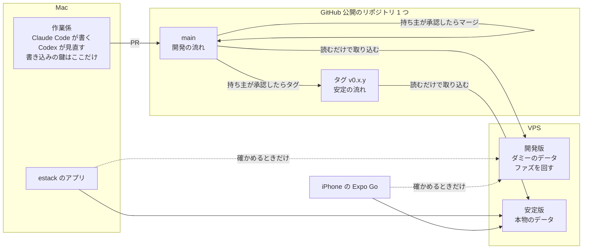

# 安定版と開発版に分ける計画

ひとことで: GitHub の公開のリポジトリ 1 つを正本にし、`main` に入るたびに VPS の**開発版**が、持ち主が承認したリリースのタグを打ったときだけ VPS の**安定版**が、GitHub から取り込んで動く形にする。Mac は書く場所（作業係）とアプリの画面だけを受け持ち、サーバーは置かない。

この文書は考え方と手順の公開版。アドレス・ユーザー名・鍵の置き場・今の機械の数字は、非公開の控え（`estack/非公開/計画.md` の 15 章）に置く。

## 1. 目ざす形

決まり:
- 流れは必ず GitHub が起点。VPS から GitHub へは何も上げない。VPS は書き込みの鍵を持たない。
- 開発版から安定版へ直接コピーしない。どちらも GitHub から取る。どの版が動いているかは GitHub を見ればわかる。
- 安定版と開発版は、データ・ポート・systemd の単位・Linux のユーザーを分ける。開発版で壊れたマージが入っても、安定版のエージェントを使って直せる。
- マージにも、安定版への昇格（タグ）にも、持ち主の承認が要る。

## 2. 今と目ざす形

| | 今（2026-11-19） | 目ざす形 |
|---|---|---|
| GitHub | 非公開のリポジトリ 1 つ。Actions は支払いの問題で止まっている。`main` を守る設定が無く、PR を通らない直接の push が入った | 公開のリポジトリ 1 つ（履歴を持たない 1 コミットから始める）。`main` を守る設定で PR と CI の緑を必須にする。公開なので標準の実行環境の Actions は無料 |
| 版の流れ | `main` だけ。マージのたびに VPS の 1 つの一式が入れ替わる | `main` が開発版、`v0.x.y` のタグが安定版 |
| VPS の estack | 1 つだけ。普段使いと開発の確かめを兼ねる | 安定版と開発版の 2 つ |
| VPS の単位 | `estack-dev`（oneshot）、`estack-metro`、`estack-github-read`。ユーザー名とパスを単位のファイルに直接書いている | `estack@stable`・`estack@dev`・`estack-metro@stable`・`estack-metro@dev` の型の単位と、`estack-github-read`（共用）。ユーザー名やパスは非公開の設定から入れる |
| データ | 開発用一式のデータ置き場（チェックアウトのパスから決まる名前）と、チェックアウトの中の account service のローカルの DB | 安定版は今のデータをそのまま使う（パスを変えない）。開発版は別のユーザーの別の置き場で、ダミーのアカウントだけ |
| ポート | 3100（account service）・3101（Signal）・3102（Signal の死活）・5173（画面）・9333（CDP）・8082（Metro）。空いていなければ別の番号に勝手にずれる | 安定版は今の番号のまま。開発版は 3300・3301・3302・5373・9433・8182。ずれずに止まる |
| 端末からの入り口 | ファイアウォールが SSH と mosh だけを通すので、Tailscale の端末から 3100 と 8082 に届かない | Tailscale Serve の HTTPS（tailnet の中だけ）で、安定版と開発版に別の入り口を作る（7 章の決めること 1） |
| 取り込み | `deploy-vps` が `main` を取り、1 つの一式を起動し直す | `deploy-vps <版>`。開発版は `main`、安定版は承認されたタグを取る |
| ファズ | Mac の作業係が手元で一時的にアプリを立てて回し、スクリーンショットを GitHub の `evidence` ブランチに上げる | マージのあと VPS の開発版で回す。スクリーンショットは公開のリポジトリに置かない |
| Mac | 作業係と、確かめのときに一時的に立てる開発用一式 | 作業係とアプリの画面だけ。PR の前の確かめは今までどおり手元で一時的に（7 章の決めること 4） |
| iPhone | Expo Go で 1 つの Metro | Expo Go で安定版と開発版の 2 つの Metro を開き分ける |

## 3. 進める段

段ごとに、コードの変更は PR にし、持ち主の承認のあとでマージする。VPS の設定・ユーザー・単位・ファイアウォール・Tailscale を変える所は、段ごとに持ち主の承認を取ってから手で入れる（「承認」の印）。

### 段 0: 今日の問題を片付ける

1. GitHub の支払いの状態を持ち主が確かめる（承認: 持ち主の操作）。公開に切り替えれば標準の実行環境は無料になるが、アカウントの支払いが止まったままだと動かないことがある。
2. `main` への直接の push を止める。公開に切り替えて守る設定を入れるまでは、作業係の PR だけで入れると決める。今日 PR を通らずに入った 2 つのコミットは、判断の記録に後から理由を書く。
3. VPS のエージェントの既定のモデルの切り替え（見直し係のほかを Muse Spark 1.3 にした件）を、持ち主が続けるか戻すか決め、判断の記録に残す（承認）。
4. 公開の準備の PR（知らない人の SNS のリンクの置き換えと、計画書の公開版と非公開版への分割）をマージする（承認）。
5. 戻し方: 1〜3 は設定と記録だけ。4 は revert の PR。

### 段 1: 公開の前に直すコード（PR を 3 本）

1. **証拠の置き場**: 作業係がスクリーンショットを GitHub の `evidence` ブランチに上げるのをやめる。証拠はリポジトリの外の非公開の置き場に置き、PR の本文には「何を確かめたか」の文と、非公開の置き場の名前だけを書く（置き場は 7 章の決めること 3）。PR の本文とコミットの文も、出す前に個人の値の検査を通す。
   - 変える物: `scripts/estack/mac-worker.ts`（`uploadEvidence`、PR の本文を作る所）、`scripts/estack/check-personal.ts`（文字列を検査する入口）、試験。
2. **版ごとに動かせる形にする**（この段では安定版の 1 つだけを今と同じ値で動かし、動きは変えない）。
   - `estack/vps/` の単位を型にする: `estack@.service`・`estack-metro@.service`。ユーザー名・パス・ポートは書かず、VPS の非公開の設定 `/etc/estack/instances/<版>.env` と、それから作る systemd の差し込み（drop-in）で入れる。
   - `estack/bin/install-vps-instance <版>`（新規）: 非公開の設定を読み、単位の差し込みを書き、チェックアウトとユーザーを確かめる。sudo で持ち主の承認のあとに手で動かす。
   - `estack/bin/dev-vps` を `estack/bin/estack-instance <版> start|stop` に置き換える。9333 番の決め打ちをやめ、その版の CDP のポートを見る。
   - `estack/bin/deploy-vps <版> [<参照>]`: 開発版は `main`、安定版は渡されたタグを取る。取り込む前に、作業中のエージェントが終わるのを待つ（今と同じ）。安定版は取り込む前にデータを控える（4 章）。
   - `estack/bin/check-metro`: その版の Metro のポートと入り口を見る。
   - `scripts/dev-services.ts`: 版の設定でポートを決めたときは、空いていなくても別の番号にずらさずに止まる（安定版と開発版が互いのポートを取らないように）。
   - `scripts/estack/queue-server.ts`: `merged` のあとは開発版だけを取り込む。新しい `release` の結果で安定版を取り込む（段 5）。（2026-11-20 に入れた。`scripts/estack/deploy-route.ts`）
   - `estack/bin/phone-qr-mac`: VPS の名前とユーザーを決め打ちせず、Mac の設定と `<版>` の引数から決める。
   - 文書（`estack/計画.md`・`estack/決まりと止める仕組み.md`）から、ユーザー名と機械の名前を外す。
3. **Android の Firebase の設定**: `apps/mobile/google-services.json` をリポジトリから外し、使うときだけリポジトリの外のファイルを `app.config` が読む形にする（7 章の決めること 6）。
4. 戻し方: それぞれの PR を revert する。2 は動きを変えないので、VPS の単位は段 3 まで今のまま動く。

### 段 2: 公開のリポジトリへ切り替える

手順は [estack の公開の手順](../docs/estack-public-release.md)。

1. Mac で `scripts/estack/export-public.ts` で書き出し、検査が全部通ることを確かめる。作者は GitHub の noreply のアドレス。
2. 持ち主が GitHub で公開のリポジトリを作り、書き出した物を push する（承認: 持ち主の操作）。
3. 公開のリポジトリの設定: `main` を守る規則（PR 必須・CI の緑必須・force push 禁止・持ち主も例外にしない）、Actions の Secrets、「Keep my email addresses private」。
4. 書き込みの App と読むだけの App を公開のリポジトリに入れ直す（承認）。Mac の `worker.json` の `repo` と git の向き先、VPS の読むだけの中継の設定の `repo` を新しいリポジトリに向ける（承認）。
5. `estack/非公開/` を `.gitignore` に入れ、計画の控えは Mac のリポジトリの外の置き場に移す。公開のリポジトリでは、このフォルダも公開されるため。
6. 今の非公開のリポジトリは書き込みを止め、履歴の控えとして残す。
7. 戻し方: 作業係と中継の `repo` を元の非公開のリポジトリに戻せば、今と同じに動く。公開のリポジトリは非公開に切り替えるか消す（承認）。

### 段 3: 今の一式を安定版の形に載せ替える

データを動かさないのが芯。開発用一式のデータ置き場の名前はチェックアウトのパスから決まるので、安定版は今のチェックアウトのパスのまま使う。

1. データを控える（4 章）。
2. 非公開の設定 `/etc/estack/instances/stable.env` に、今のユーザー・パス・ポート（3100 番台・5173・9333・8082）と、今のデータ置き場の名前（`ESTACK_DEV_INSTANCE_ID`）をそのまま書く。パスの名前から決まる値を、明示の値で固定する。
3. `estack-dev` と `estack-metro` を止め、`estack@stable` と `estack-metro@stable` を有効にして起動する（承認）。
4. エージェントの会話・ルーチン・サインインがそのまま残っていることを、持ち主がアプリで確かめる。
5. 最初の安定版のタグ `v0.1.0` を、今の `main` に打つ（承認）。安定版はこれ以降、承認されたタグのときだけ取り込む。
6. 戻し方: 新しい単位を止め、`estack-dev` と `estack-metro` を元どおり有効にする。データは同じ置き場なので、そのまま戻る。

### 段 4: 開発版を立てる

1. 開発版用の Linux のユーザーを作る（承認）。安定版の本物のデータを、開発版のコード（マージされたばかりの物）から読めないようにするため。
2. そのユーザーのホームに読むだけの中継から `main` を取り、`bun install`。account service のローカルの DB も、このチェックアウトの中に別にできる。
3. `/etc/estack/instances/dev.env` に、開発版のポート（3300・3301・3302・5373・9433・8182）とダミーのアカウントを書き、`estack@dev` と `estack-metro@dev` を有効にする（承認）。
4. メモリが足りるかを見る。足りなければ、開発版は取り込みとファズのときだけ起動し、終わったら止める形にする（7 章の決めること 5）。
5. 戻し方: `estack@dev` と `estack-metro@dev` を止めて無効にする。安定版には触れない。

### 段 5: 取り込みの流れと昇格

1. マージのあとの流れ: 作業係が `merged` を伝える → 受け口が `deploy-vps dev` → 開発版でファズ → 結果を判断の記録に残す。
   - 2026-11-20 に入れた。受け口は `sudo -n -H -u <開発版のユーザー> <開発版のチェックアウト>/estack/bin/deploy-vps dev` だけを動かせる（`install-vps-instance dev` が sudoers の 1 行を書く）。`deploy-vps` は引数なしでは動かない（安定版に `main` を入れる道を断った）。
   - 受け口の台本は安定版のチェックアウトでなく、`main` を追う受け口専用のチェックアウトで動かす（`authorized_keys` の `command=` と、sshd の `Match User` の `ForceCommand` の両方をそこの `estack/bin/queue-server` へ向ける。sshd は `ForceCommand` を `command=` より先に使うので、片方だけでは古い受け口が動き続ける）。`merged` と `deploy` のたびに `estack/bin/update-queue-code` が早送りで追いつく。安定版が古いタグのままでも、受け口の決まりは `main` の物になる。
2. ファズを Mac から VPS の開発版に移す。VPS の中で開発版の CDP（127.0.0.1 のポート）につなぐ。スクリーンショットは段 1 の非公開の置き場へ。
3. 昇格: 開発のリードが「この版を安定版にしたい」と、`main` のどのコミットか・開発版のファズの結果・変わった点をまとめ、開発チャンネルで持ち主に聞く。持ち主の承認のあと、Mac で `estack/bin/mac-worker release v0.x.y --approved "<持ち主の承認の文>"` を動かす。作業係が書き込みの App で `main` の先にタグを打ち、判断の記録に残し、受け口に `release v0.x.y` を送る。受け口は `deploy-vps stable v0.x.y` を動かす（2026-11-20 に入れた）。
4. 安定版の取り込みは、タグが `main` から届くこと・開発版のファズがそのコミットで通っていることを確かめてから行う。
5. 戻し方: 安定版は 1 つ前のタグを `deploy-vps stable <前のタグ>` で取り込み直す。データの形が変わっていたら、取り込む前の控えを戻す（4 章）。

### 段 6: 端末からの入り口

1. Tailscale Serve の HTTPS（tailnet の中だけ）で、安定版と開発版に別のポートの入り口を作る（承認）。account service・Signal（wss）・Metro を、それぞれの版の 127.0.0.1 のポートにつなぐ。デスクトップのアプリは account service を HTTPS か自分の機械の中の HTTP でしか受け付けず、Signal も wss だけなので、HTTPS の入り口が要る。
2. Mac のアプリ: 普段は安定版の入り口、確かめるときだけ開発版の入り口を使う。切り替えの仕方（設定画面か、起動のときの設定か）は段 6 で決めて PR にする。
3. iPhone の Expo Go: 安定版と開発版の Metro の URL を、それぞれ QR で開く（`phone-qr-mac <版>`）。Expo Go が HTTPS の Metro を読み込めることを、最初に開発版で確かめる。読み込めなければ、ファイアウォールで Tailscale の口にだけ Metro と account service のポートを開ける案に切り替える（承認）。
4. 戻し方: その版の Serve の設定を消す（ほかのサービスの Serve には触れない）。ファイアウォールを開けた場合は、その規則だけを消す。

## 4. データの控えと移し方

- 安定版の本物のデータは 3 か所: 開発用一式のデータ置き場、account service のローカルの DB（チェックアウトの中）、持ち主のサインインの設定（リポジトリの外）。
- 段 3 ではパスを変えないので、データは移さない。置き場の名前を明示の値で固定し、あとでパスが変わっても同じ置き場を使う。
- 安定版の取り込みの前に毎回、エージェントを止めてから 3 か所を 1 つの控えにまとめ、新しい 3 つを残す。戻すときは止めて、控えを書き戻す。
- 開発版には本物のデータを移さない。ダミーのアカウントと空の状態から始める。

## 5. 持ち主の承認が要る所

| 所 | 何を承認するか |
|---|---|
| 段 0 | Muse Spark の既定を続けるか、計画書の分割と SNS のリンクの PR のマージ |
| 段 1 | 3 本の PR のマージ |
| 段 2 | 公開のリポジトリの作成と push、App の入れ直し、作業係と中継の向き先の変更 |
| 段 3 | 単位の載せ替え、最初のタグ `v0.1.0` |
| 段 4 | 開発版のユーザーと単位の追加 |
| 段 5 | 毎回の安定版への昇格（タグ） |
| 段 6 | Tailscale Serve の追加、またはファイアウォールの規則の追加 |
| いつも | マージ、配備、人への送信、お金、データの削除 |

## 6. 気をつけること

- **メモリ**: 1 つの一式とその Metro だけで数 GB を使い、同じ VPS にほかのサービスもいる。開発版を常に動かすと足りなくなるおそれがある。段 4 で測ってから、常に動かすか、使うときだけにするかを決める。
- **データの置き場の名前**: チェックアウトのパスから決まる。安定版のパスを変えると、空の置き場で起動してしまう。段 3 で明示の値に固定するまで、パスを動かさない。
- **ポートのずれ**: 今のスクリプトは、ポートが空いていないと別の番号に勝手にずれる。安定版が止まっている間に開発版が安定版の番号を取らないよう、段 1 でずれずに止まる形にする。
- **自分を直す道具**: 安定版を分けるまでは、壊れたマージで普段使いのエージェントまで止まる。段 3 と段 4 を先に済ませる。
- **証拠と PR の本文**: 公開のリポジトリでは、スクリーンショットや PR の本文に写った物が誰にでも見える。段 1 を公開より先に済ませる。
- **Tailscale Serve の共用**: 同じ VPS のほかのサービスも Serve を使っている。estack の分だけを足し、消すときも estack の分だけを消す。

## 7. 決めること（持ち主）

1. 端末からの入り口: Tailscale Serve の HTTPS（おすすめ。ファイアウォールを変えない）か、ファイアウォールで Tailscale の口にポートを開けるか。
2. 安定版のタグの付け方: `v0.x.y` で、昇格のたびに y を上げる形でよいか。
3. 証拠の置き場: 非公開の別のリポジトリ、VPS の非公開の置き場、開発チャンネルへの添付のどれにするか。
4. PR の前の確かめ: Mac の手元で一時的にアプリを立てる（決定済み 2026-11-19）。2 つ目の確認用の常駐アプリは作らない: 確認はその時のコードで一時的に立て、データは既に別の「estack Dev」プロファイルに分かれる。
5. 開発版を常に動かすか、取り込みとファズのときだけ動かすか（メモリを測ってから）。
6. Android の Firebase の設定を外してよいか（今は使っていない）。
7. VPS のユーザー名: 公開のファイルからは消す。VPS の上で名前まで変えるか（変えなくても公開には出ない）。
8. 公開のリポジトリの名前と、外からの PR を受け付けないと README に書くか。
