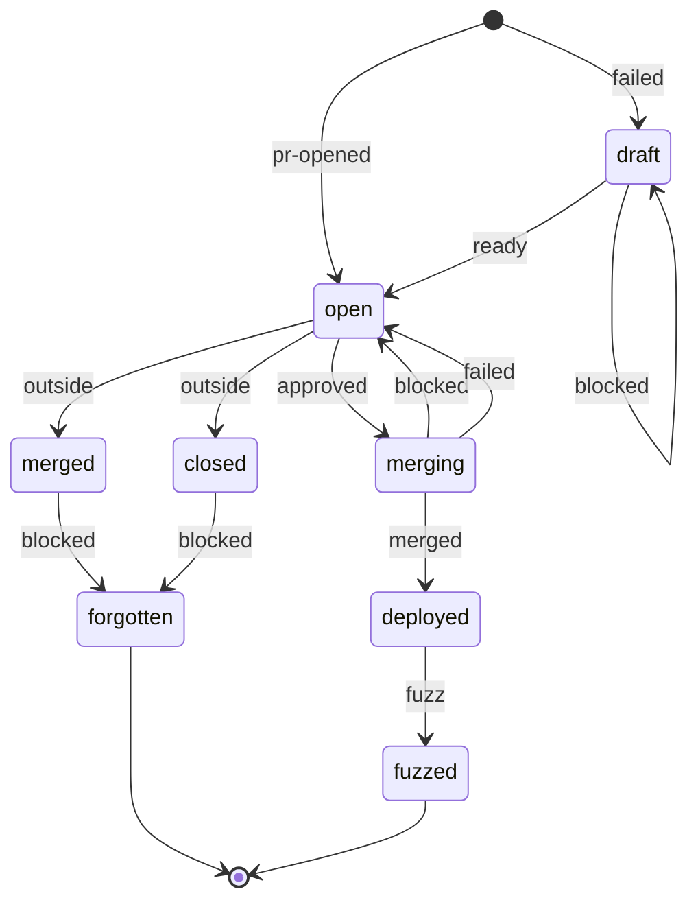

# 作業係の PR の状態

Mac の作業係（`scripts/estack/mac-worker.ts`）が持つ PR の状態と、マージの頼みへの答え。`scripts/estack/state-charts.test.ts` が、この図とコード（`PULL_STAGES`・`RESULT_STATES`・`earlyMergeAnswer`・`sessionIsDone`・`startsDeploy`）が同じ形かを確かめる。図かコードの片方だけを変えると試験が落ちる。

- 矢印の名前は、作業係が返す答え（`RESULT_STATES`）か、外で起きたこと（`approved`・`outside`・`ready`・`fuzz`）。
- `deployed` に入れるのは、作業係がその呼び出しで自分でマージした `merging` からだけ。`fuzzed` に入れるのは `deployed` からだけ。マージ済み・閉じた PR は `forgotten`（`sessions.json` から消す）へ行き、反映もファズも起こさない。

